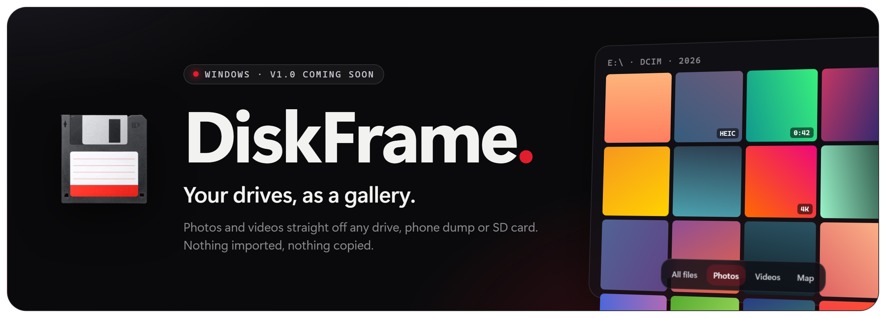
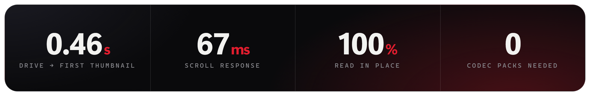

<p align="center">
  
</p>

<p align="center">
  <b><a href="#download">Download</a></b> ·
  <a href="#what-it-does">Features</a> ·
  <a href="#fast-on-big-drives">Performance</a> ·
  <a href="#how-its-built">How it's built</a> ·
  <a href="#made-by">Made by</a>
</p>

<p align="center">
  
  <a href="https://github.com/NSBforever/DiskFrame/releases/latest"></a>
  
  
  
  
  
  
</p>

<p align="center">
  
</p>

> **Every phone dump I copied to a drive turned into folders of `IMG_4821.HEIC` I couldn't browse.** Windows Photos wants to import everything first, and it can't show iPhone HEIC photos or HEVC videos without a codec pack. So I built DiskFrame: plug in a drive, open it, and scroll through it like a phone gallery.

## Download

**[Download DiskFrame 1.0.0 for Windows](https://github.com/NSBforever/DiskFrame/releases/latest/download/diskframe-1.0.0-setup.exe)** (installer, 270 MB). A portable build that runs without installing is on the [release page](https://github.com/NSBforever/DiskFrame/releases/latest).

The installer is not code-signed yet, so Windows SmartScreen may say "Windows protected your PC". Choose **More info**, then **Run anyway**. Your catalogue and thumbnails live in `%APPDATA%\diskframe`; upgrading or uninstalling leaves them in place.

## What it does

| | |
|---|---|
| **💽 Open any drive** | External HDDs and SSDs (even asleep ones), SD cards, phone dumps and internal folders. Thumbnails for the screen you're looking at come first. |
| **🗓️ Timeline or grid** | Group by day, month, year or place, jump through years with the date scrubber, and resize tiles with Ctrl + scroll. |
| **📱 Phone formats, no extras** | iPhone HEIC photos and 4K HEVC video are decoded inside the app. Other formats (ProRes, MKV, AVI, WMV) fall back to a bundled mpv player. |
| **🗺️ Places** | Photos with GPS data appear on a map and a 3D globe. |
| **🔎 Search** | Fuzzy search across everything on the drive. |
| **⭐ Favourites and Trash** | Kept per drive. Trash removes a tile the moment you click, and counts, selection and the viewer follow along. |
| **🔄 Stays in sync** | DiskFrame watches the open drive, so files added, moved or deleted outside the app show up without a rescan. |
| **🎬 A viewer that feels native** | Photos and videos open from their tile as a shared-element transition, and close back into it. |

## Fast on big drives

Measured on a 40,000-file test drive on a Ryzen 7 laptop, before and after a profiling pass:

| | Before | Now |
|---|---:|---:|
| Open a drive to the first thumbnail | 6.9 s | **0.46 s** |
| Scroll input response (median) | 188 ms | **67 ms** |
| Longest main-thread stall while scrolling | 8.1 s | **87 ms** |

How it got there:
- thumbnails for the visible screen are scheduled first, and stale screens are dropped;
- catalogue reads, HEIC decoding and ffmpeg all run on worker threads;
- file-watcher events caused by DiskFrame's own reads are ignored.

## How it's built

- **Electron 39**, **React 19** and **TypeScript**, built with electron-vite. The gallery grid is virtualised with react-virtuoso.
- **SQLite** (better-sqlite3) holds the catalogue, keyed by volume and path. Reads are served from a library worker, so a drive letter that changes never mixes up two drives.
- **Thumbnails**:
  - **sharp** for photos;
  - **libheif** (WebAssembly) for HEIC, on its own worker;
  - **FFmpeg** for video frames, started from a worker thread.

  The thumbnail, transcode and HEIC caches each have a size budget.
- **Playback** uses a bundled **mpv** with hardware decoding. Chromium's own player, served by a byte-range `media:` protocol, takes over in safe mode or if mpv fails.
- An optional **Rust** module (napi-rs) reads the NTFS Master File Table directly, for very fast scans when DiskFrame runs as administrator.
- **Leaflet** and **react-globe.gl** for the places map and globe. EXIF is read with exifr.

## Status

**v1.0.0 is out.** What changed and what is still known to be limited: [release notes](docs/RELEASE_NOTES_1.0.0.md) and the [engineering audit](docs/V1_AUDIT.md). Ideas and bug reports are welcome: [open an issue](https://github.com/NSBforever/DiskFrame/issues).

Third-party licences, including mpv (GPLv2+), are listed in [NOTICE](NOTICE).

## Made by

**Sai Baba Nagi Reddy (NSB)**: [LinkedIn](https://www.linkedin.com/in/sai-baba-nagi-reddy-02257836a/) · [Instagram](https://www.instagram.com/nsbforever_7/) · [GitHub](https://github.com/NSBforever)

<p align="center"><sub>Also by me: <a href="https://github.com/NSBforever/stashley-showcase"><b>Stashley</b></a>, a bookmark library that sorts itself.</sub></p>

<details>
<summary>Build from source</summary>

```bash
npm install
npm run dev        # run in development
npm run build:win  # Windows installer (needs resources\bin\win\mpv.exe, see below)
```

mpv.exe is about 117 MB and not in git; 1.0 ships mpv v0.41.0 from [mpv.io](https://mpv.io/installation/). `scripts/verify-pack.cjs` fails the build if mpv, ffmpeg, ffprobe, better-sqlite3 or sharp is missing from the package. Checks: `npm test`, `npm run typecheck`.

</details>
